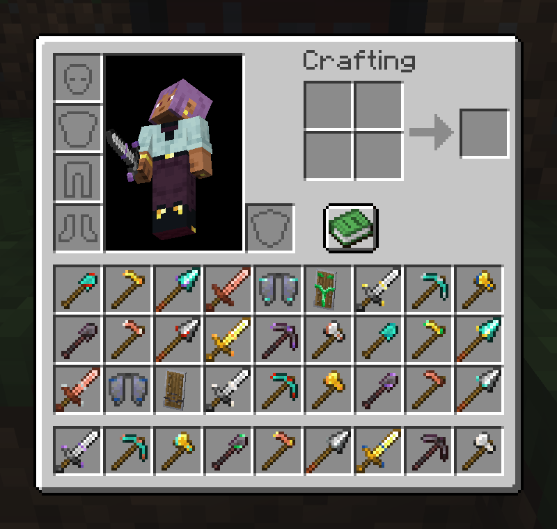
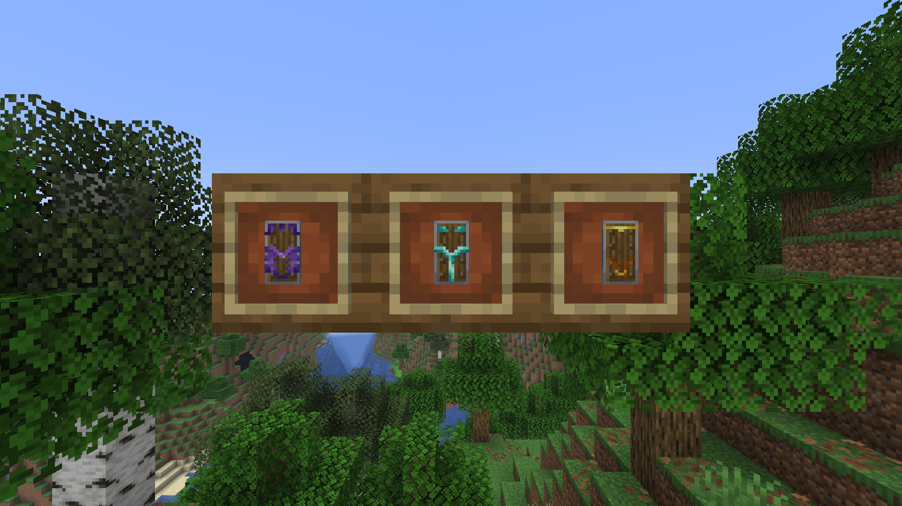
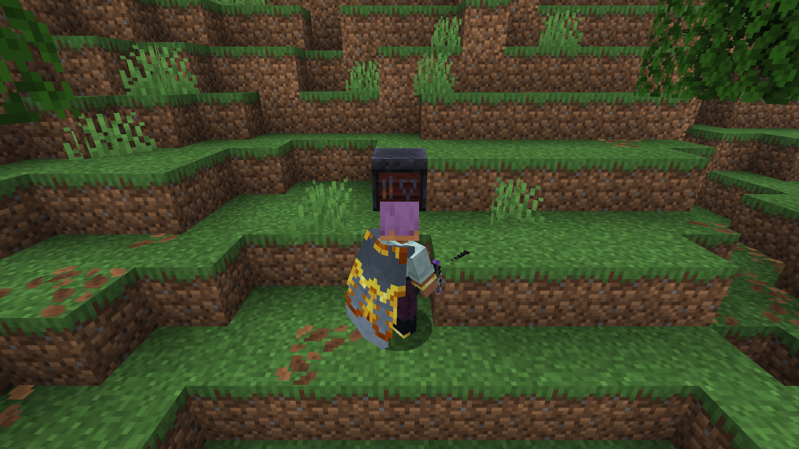
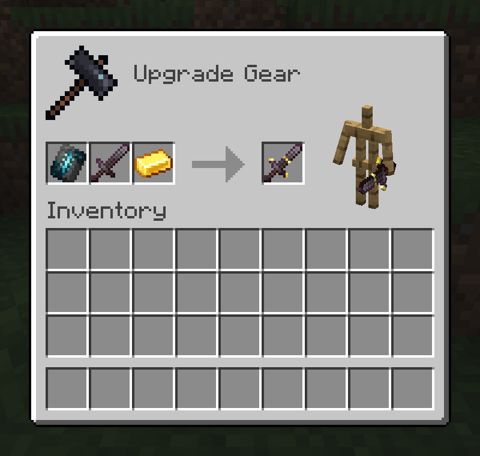
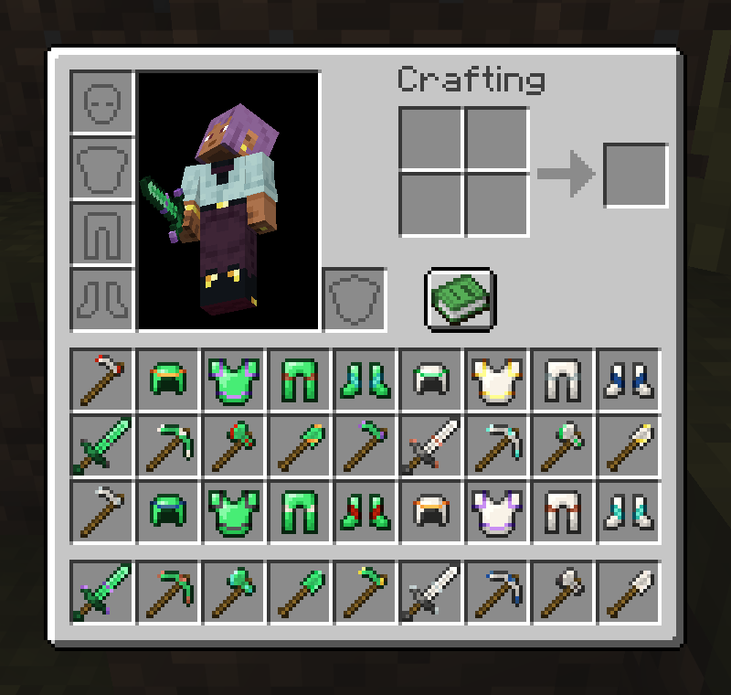

# Smithing Templates

A Fabric mod that lets the armor trim templates trim tools, elytra and shields too.

## Features

- **The same table, the same three slots**: a trim template, a tool and a trim material go in the smithing table where a template, a piece of armor and a material go now, and a trimmed tool comes out. The templates are vanilla's own; nothing new is crafted or found.
- **Every vanilla tool worth inlaying**: swords, pickaxes, axes, shovels, hoes and spears, in copper, iron, gold, diamond and netherite, all take every pattern. Wooden and stone tools do not: too plain a stock to inlay.
- **The suite's gear too**: Emerald Tools and Quartz Tools take every pattern when they are installed, drawn on them the same as on vanilla's. Emerald Armor and Quartz Armor take armor trims and show them on their icons.
- **Elytra too, in flight**: an elytra takes every pattern as well. Its icon shows the trim as an armor icon does, and the wings you wear show the pattern itself, vanilla's own worn trim for it: the helmet's band and the chestplate's emblem. A broken elytra's torn icon shows no trim; the wings still do.
- **Shields too, on the face**: a shield takes every pattern across the front of its plate, vanilla's own worn trim for it, the helmet's band over the chestplate's emblem, shown on the icon and on the shield itself whether carried or raised to block, by you or anyone holding it. It sits over any banner pattern the shield already has.
- **Trimmed the way armor is**: a tool's icon shows its trim as vanilla's armor icons do, a few short bands of the material at the head's points and joints: a sword's blade and crossguard, a pickaxe's points and collar, an axe's edge. The pattern shows in the tooltip; on a tool's small head every pattern draws the same inlay, as every pattern does on an armor icon. Shields and worn elytra, where there is room, show the pattern itself.
- **In the material's colour**: every trim material colours the inlay the way it colours armor, and a tool in a trim of its own metal takes the darker shade, as iron trim on iron armor does.
- **Shown where the tool is**: in the inventory, in the hand, on the ground, in an item frame, and on the smithing table's preview. A spear held in the hand switches to vanilla's larger in-hand model, which carries no trim yet.
- **A trim strengthens what it is on**: any trimmed piece, armor or tool, lasts a quarter longer than a plain one. Trimming it again in another pattern or material swaps the look; it does not add a second quarter.
- **Gold trim placates piglins**: a piglin leaves you alone if any armor you wear, an elytra included, has a gold trim, just as it does if you wear a piece made of gold. A gold-trimmed tool in your hand does not count, the same as vanilla's gold rule.
- **Templates that say so**: the patterns drop "Armor" from their names (Sentry Trim, not Sentry Armor Trim), each template lists tools, elytra and shields beside armor, and the empty base slot asks for armor, a tool, an elytra or a shield.

## Pandorical

Smithing Templates runs server-side, and Pandorical is required: the server will not load this mod without it. Trimming, the extra durability and the piglins are all decided on the server, so they hold for every player. The trim's art and the templates' wording reach clients through Pandorical's content sync.

**The Pandorical mod must be installed client-side** to see the trim on the tool. Without it a trimmed tool looks like a plain one, and its tooltip still names the pattern and material.

## Development

Installing and the art pipeline are in [DEVELOPMENT.md](DEVELOPMENT.md).

## License

MIT, see [LICENSE](LICENSE).
